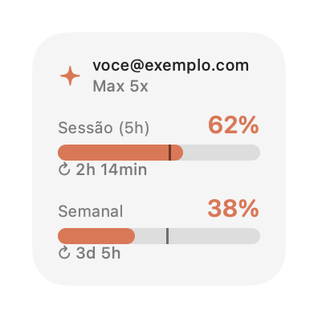
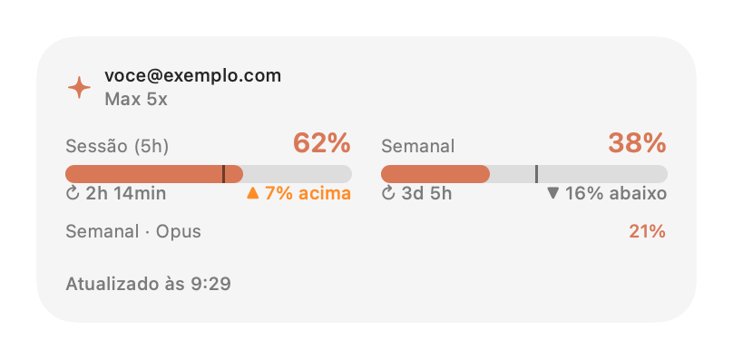
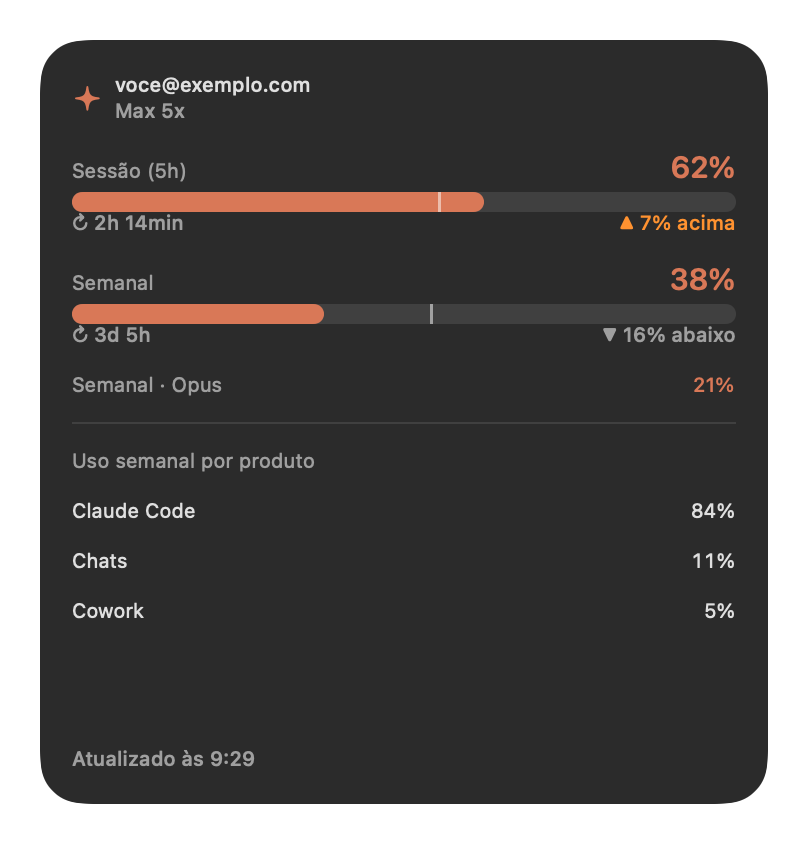

# Claude Usage — widget para macOS

Widget de área de trabalho (WidgetKit) que mostra em tempo real quanto do seu plano do Claude você já consumiu: o **limite da sessão de 5 horas**, o **limite semanal**, a conta logada e se você está gastando mais rápido do que o tempo passa. Um app leve na barra de menus atualiza os dados **a cada minuto**.

<p align="center">
  
  
</p>
<p align="center">
  
</p>

> As imagens usam dados fictícios. Geradas a partir das views reais do widget com `scripts/render-previews.sh`.

## O que o widget mostra

| Informação | Pequeno | Médio | Grande |
|---|:-:|:-:|:-:|
| E-mail da conta e plano (Pro, Max 5x, Max 20x) | ✅ | ✅ | ✅ |
| Sessão (5h): % usado e tempo até resetar | ✅ | ✅ | ✅ |
| Semanal: % usado e tempo até resetar | ✅ | ✅ | ✅ |
| Ritmo de uso (acima/abaixo do esperado) | marcador | ✅ | ✅ |
| Limite semanal por modelo (ex.: Opus) | | ✅ | ✅ |
| Uso semanal por produto (Claude Code, Chats, Cowork…) | | | ✅ |
| Horário da última atualização / erro | | ✅ | ✅ |

### Como ler o ritmo

Cada barra tem um **traço vertical** que marca quanto da janela de tempo já passou. Se a barra colorida passou do traço, você está consumindo mais rápido do que o tempo: no ritmo atual, vai bater o limite antes do reset.

- `▲ 7% acima`: 7 pontos percentuais acima do esperado para este momento da janela
- `▼ 16% abaixo`: sobra folga
- `no ritmo`: diferença de até 5 pontos

As cores mudam conforme o uso: laranja-Claude até 70%, laranja de alerta a partir de 70% e vermelho a partir de 90%.

## Requisitos

- macOS 14 (Sonoma) ou mais recente
- [Claude Code](https://claude.com/claude-code) instalado e com login feito (`claude` → `/login`) usando uma conta Pro ou Max
- Para compilar: Xcode 15+ e [XcodeGen](https://github.com/yonaskolb/XcodeGen) (`brew install xcodegen`)

## Instalação

```bash
git clone git@github.com:rafaelsilvestre/claude-usage-macos-widget.git
```

```bash
cd claude-usage-macos-widget && xcodegen generate
```

Antes de compilar, troque o time de assinatura e o App Group pelo seu (veja [Usando com sua própria conta Apple](#usando-com-sua-própria-conta-apple)). Depois:

```bash
xcodebuild -project ClaudeUsage.xcodeproj -scheme ClaudeUsage -configuration Release -derivedDataPath build -allowProvisioningUpdates build
```

```bash
cp -R build/Build/Products/Release/ClaudeUsage.app /Applications/ && open /Applications/ClaudeUsage.app
```

Depois, adicione o widget:

1. Clique com o botão direito na área de trabalho → **Editar Widgets…**
2. Procure **Uso do Claude**
3. Escolha o tamanho (pequeno, médio ou grande) e arraste para a área de trabalho ou para a Central de Notificações

No menu da barra superior (ícone `✳︎ 62%`), marque **Abrir no login** para o app continuar atualizando o widget depois de reiniciar o Mac.

## Como funciona

```
┌────────────────────────┐   a cada 60s   ┌──────────────────────────────┐
│  ClaudeUsage.app       │ ─────────────▶ │ api.anthropic.com/api/oauth/ │
│  (barra de menus)      │ ◀───────────── │   usage  ·  profile          │
└──────────┬─────────────┘                └──────────────────────────────┘
           │ grava usage.json no App Group
           │ + WidgetCenter.reloadAllTimelines()
           ▼
┌────────────────────────┐
│  UsageWidget (WidgetKit)│  lê usage.json e desenha;
│  sandbox                │  contagem regressiva minuto a minuto
└────────────────────────┘
```

1. **Credenciais.** O app lê o token OAuth que o Claude Code guarda no Keychain (item `Claude Code-credentials`), usando `/usr/bin/security`. Nenhuma senha é pedida ou armazenada pelo app.
2. **Consulta.** A cada 60 segundos, chama os mesmos endpoints que o Claude Code usa para exibir seus limites: `/api/oauth/usage` (porcentagens e horários de reset) e `/api/oauth/profile` (e-mail e plano, buscado uma vez por execução).
3. **Compartilhamento.** O resultado é salvo em `~/Library/Group Containers/<App Group>/usage.json`, e o app pede ao WidgetKit para recarregar o widget.
4. **Widget.** A extensão roda em sandbox e só lê esse arquivo. A linha do tempo tem uma entrada por minuto, então a contagem regressiva continua andando mesmo entre recargas.

### Estrutura

```
App/                 app da barra de menus (busca dados, menu, abrir no login)
  ClaudeUsageApp.swift
  UsageFetcher.swift
Widget/              extensão WidgetKit (views e timeline)
  UsageWidget.swift
Shared/              modelo e armazenamento compartilhados via App Group
  UsageData.swift
scripts/             geração das imagens do README
project.yml          definição do projeto (XcodeGen)
```

## Usando com sua própria conta Apple

O projeto vem configurado com o time `G9PHDKA735`. Para compilar com a sua conta:

1. Descubra seu Team ID: `security find-certificate -c "Apple Development" -p | openssl x509 -noout -subject` (é o valor de `OU=`)
2. Substitua `G9PHDKA735` pelo seu Team ID em:
   - `project.yml` (`DEVELOPMENT_TEAM` e os dois `application-groups`)
   - `Shared/UsageData.swift` (`appGroupID`)
3. Se quiser, troque também o prefixo `com.rafaelsilvestre` dos bundle IDs
4. Rode `xcodegen generate` de novo

## Solução de problemas

| Sintoma | Causa provável / solução |
|---|---|
| ⚠️ "Credenciais do Claude Code não encontradas" | Faça login no Claude Code (`claude` → `/login`). |
| ⚠️ "Token expirado — abra o Claude Code" | O token OAuth venceu. Use o Claude Code uma vez para ele renovar o token, e o widget volta sozinho no minuto seguinte. |
| Widget mostra dados de exemplo | O app não está rodando ou ainda não fez a primeira busca. Abra `ClaudeUsage.app`. |
| Porcentagem demora a mudar | O macOS limita a frequência de recarga de widgets. A contagem regressiva é por minuto, mas os números podem atrasar alguns minutos. O menu da barra superior sempre mostra o valor mais recente. |
| Widget não aparece na galeria | Abra o app pelo menos uma vez a partir de `/Applications` e tente de novo. Se continuar, rode `killall NotificationCenter`. |

## Regenerar as imagens

```bash
./scripts/render-previews.sh
```

Renderiza as views reais do widget com dados fictícios em `docs/images/` (modos claro e escuro).

## Aviso

Projeto pessoal, não oficial e sem vínculo com a Anthropic. Os endpoints `/api/oauth/*` não são documentados publicamente e podem mudar sem aviso.
